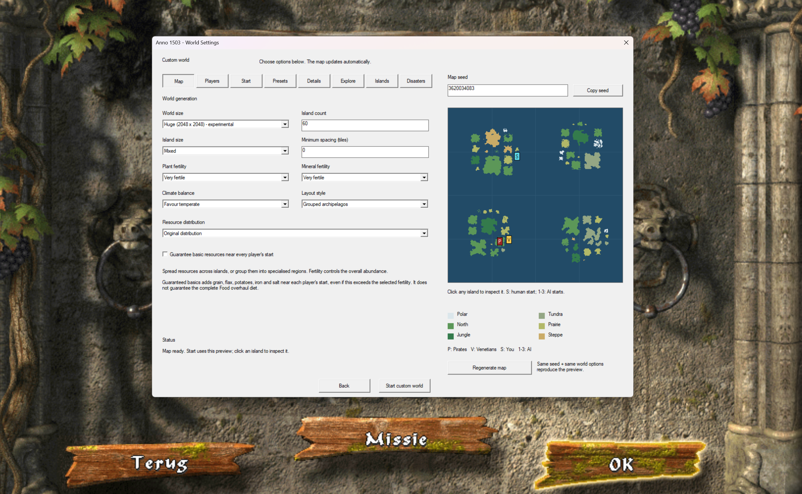
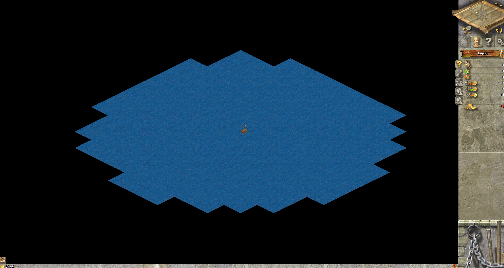

# Anno 1503 Grand Overhaul

**Customize single-player endless games in Anno 1503 History Edition.** Preview a map, fine-tune the world generator, and save your favourite settings as a preset, all inside the game.

> **[Join the Grand Overhaul Discord](https://discord.gg/hbvms52jkR)** for installation help, release announcements, playtesting, and world seed sharing.

**[Download the Windows beta](https://github.com/GOjayson/anno1503-grand-overhaul/releases)** · [Quick install](#install-the-windows-beta) · [Screenshots](#screenshots) · [Changelog](docs/CHANGELOG.md)

## Install the Windows beta

> [!IMPORTANT]
> The public beta targets the **64-bit Anno 1503 History Edition build with Dutch scene data**. You need a legitimate copy and a normal Ubisoft Connect session. Other localizations still need verification. Compatibility depends on the installed game files and scene data.

1. Open [GitHub Releases](https://github.com/GOjayson/anno1503-grand-overhaul/releases) and download the **Windows beta ZIP** under **Assets**. Extract the whole archive outside your Anno installation.
2. Close Anno and open **Anno1503OverhaulSetup.exe**.
3. Confirm the **Original game folder** and choose a separate **Modded copy folder**. Keep **World Settings** selected and **Food** unchecked.
4. Click **Check installation**, then **Install selected features**.
5. Launch from the new desktop shortcut or click **Start with World Settings**. Start a single-player endless game and choose **Custom world**.

For setup errors and manual recovery, see the [full installation and troubleshooting guide](docs/INSTALLER.md).

How the installer and launcher work

The Windows bundle includes the mod and its preparation tools. The installer
builds the modded copy from the executable, DLLs, and island data in your
supported Anno installation. The preparation tools handle Python and compiler
requirements. Your saves stay with your own installation and backups.

The launcher uses a normal Ubisoft Connect session to open the modded copy and
closes the temporary launch menu after handoff. The
[third-party notices](docs/THIRD_PARTY_NOTICES.md) list bundled tool licenses.

## What you can customize

In a single-player endless game, **Custom world** opens the World Settings
menu. Preview or regenerate the map, reuse a seed, or load a preset.
**Original game** uses Anno's built-in setup and generation. Tutorials,
campaigns, and scenarios follow their usual start flow.

| Settings | Examples |
| --- | --- |
| World and islands | Map and island sizes, island count, spacing, layout, and random rotation |
| Climate and terrain | Climate preferences, minimum and maximum climate counts, and island shape preferences |
| Resources | Plant fertility, minerals, resource distribution, and balanced starting positions |
| Starts and opponents | Starting money, fleet and cargo, plus up to three ordinary AI opponents and their aggression |
| Factions and trade | Individual native cultures, Pirates, Venetians, pirate activity, and neutral merchant traffic |
| Visibility and disasters | Terra incognita, map and enemy activity visibility, remembered towns, and disaster frequency and severity |

**Huge worlds (2048 × 2048) are experimental.** The
[world options and validation guide](docs/WORLD_ENVIRONMENT_OPTIONS.md) covers
observed game runs, automated checks, and what still needs testing. See the
[island catalogue audit](docs/WORLD_ISLAND_CATALOGUE.md) for island coverage.

### Screenshots

**World Settings and map preview.** The **Grouped archipelagos** layout in an
experimental **Huge (2048 × 2048)** world configured for 60 islands.

**Terra incognita in-game.** A starting ship reveals the water around it as
the rest of the world waits to be explored.

[Browse all 15 screenshots](docs/SCREENSHOTS.md) to see more World Settings
options and the Food overhaul from the source development build.

## Optional Food overhaul and Bug Fixes

The source installer, **[INSTALLER.cmd](INSTALLER.cmd)**, offers independent
**World Settings**, **Food overhaul** and **Bug Fixes** checkboxes. The Food
version remains an explicit choice. Select **Food 0.6** for new worlds with
tier-specific diets, an informative household Food bar using the original
Food icon, and matching food-icon backgrounds. All three features can be
selected together. See the [Food guide](docs/FOOD_OVERHAUL.md) and
[combined validation record](docs/FOOD_WORLD_VALIDATION.md).

**Bug Fixes** corrects the King of Ore quest instructions and reduces the
volume of 118 sound effects per installed supported language. It reconstructs
the quieter samples from your own original files. The Dutch quest was checked
in-game; the other language replacements and sound reductions have separate
automated and file checks. Read the [Bug Fixes scope](docs/BUGFIX_RESEARCH.md).

Food 0.6 and the combined profile are **source development candidates**. They
need Python, the reviewed compiler and the matching local preparation inputs
described in the [installer guide](docs/INSTALLER.md). Start a new endless
world; vanilla and Food 0.5 saves are not migrated. The published Windows beta
ZIP remains the earlier World Settings-only release.

## Restore or change features

Close Anno, select your **Modded copy folder** in setup, and click
**Restore original game**. Restore before changing the installed feature
combination. This preserves the original Ubisoft installation, saves, and
existing backups.

> [!NOTE]
> Keep a compatible modded installation for any custom-world saves that still depend on it, especially Huge worlds.

The preserved **Food 0.5** recipe and its matching combined development
profile remain available. Food versions use separate exact compatibility
checks. Better AI, eight ordinary AI players, local-host multiplayer and the
Knowledge overhaul remain future work.

## Community and support

- **[Join Discord](https://discord.gg/hbvms52jkR)** to ask for installation or gameplay help, share a seed, or follow release announcements. The invite opens **#welcome**.
- **[Report a bug or suggest a feature](https://github.com/GOjayson/anno1503-grand-overhaul/issues/new/choose)** on GitHub. Include the mod version, selected features, game mode, steps to reproduce, what you expected, and what happened.
- **[Accessibility and reporting barriers](ACCESSIBILITY.md)** explains how to ask for help when the usual reporting process gets in the way.
- **[Report a security vulnerability privately](SECURITY.md)** using the project's security policy.

Keep a copy of any affected save. Remove Ubisoft startup arguments and account
information before sharing logs or screenshots, and keep original game files
private.

## Contributing

Read the [contribution guide](CONTRIBUTING.md), [Code of Conduct](CODE_OF_CONDUCT.md),
and [repository instructions](AGENTS.md). The
[development history](docs/DEVELOPMENT_HISTORY.md) covers source setup and the
earlier implementation work.

Develop in this repository outside the installed game. The public repository
contains mod source, tests, authored assets, and documentation. Keep native game
files and local build and test data private.

## License

Original code, documentation, and authored artwork are available under the
[MIT License](LICENSE) where a separate license is absent. Third-party
components and the adapted Code of Conduct retain their own terms. See the
[third-party notices](docs/THIRD_PARTY_NOTICES.md).

Anno 1503 Grand Overhaul is an independent community project and requires a
supported Anno installation. Ubisoft's game files, assets, and trademarks
remain subject to their own terms.
