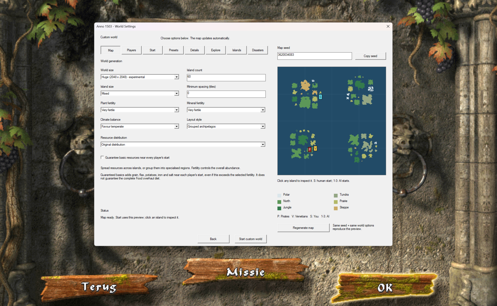
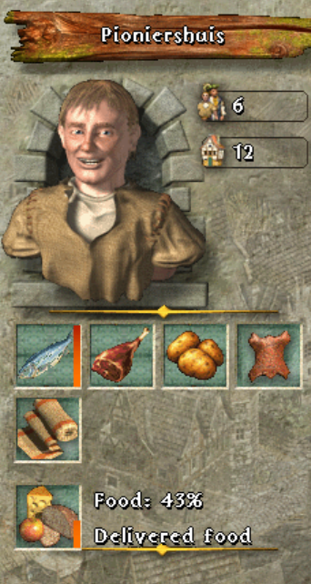
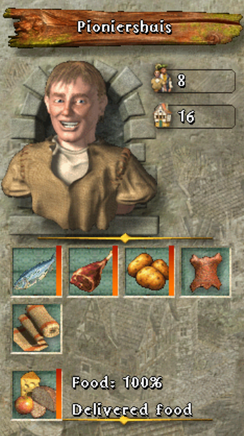
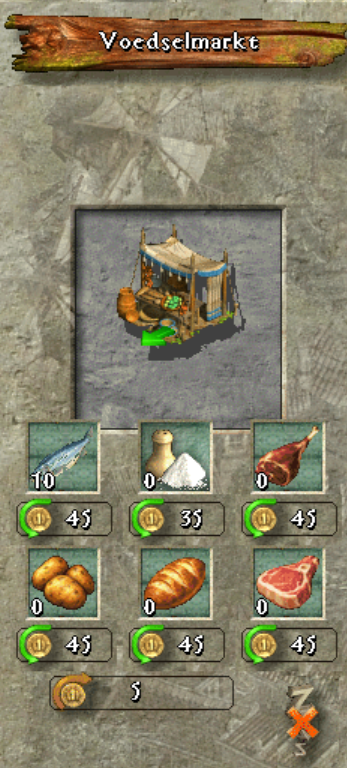

# Anno 1503 Grand Overhaul screenshots

[Back to the README](../README.md) · [World Settings](#world-settings) · [Food overhaul](#food-overhaul)

## World Settings

Start a single-player endless game and choose **Custom world** to open World
Settings. Select a screenshot title to view it at full size.

The **Grouped archipelagos** preview uses seed `3620034083` with 60 islands
and the experimental **Huge (2048 × 2048)** size. The same seed and world
options reproduce the preview.

| Screenshot | What it shows |
| --- | --- |
| [New endless game](screenshots/choose-world-type.png) | Choose **Original game** or **Custom world**. |
| [Map · Evenly spread](screenshots/map-evenly-spread.png) | World size, island count, fertility and resource options, with islands spread across the map. |
| [Map · Grouped archipelagos](screenshots/map-grouped-archipelagos.png) | The same seed with islands arranged into four groups. |
| [Players](screenshots/players-and-cultures.png) | AI difficulty, native cultures, Pirates, Venetians and merchant traffic. |
| [Start](screenshots/starting-options.png) | Starting money, fleet, climate preference and custom trade ship cargo. |
| [Presets](screenshots/presets.png) | Save and reload a set of world options together with its map seed. |
| [Details](screenshots/island-details.png) | Inspect an island's terrain and resources, and choose it as a preferred starting position if eligible. |
| [Explore · Geography revealed](screenshots/geography-revealed.png) | Reveal island locations while restricting enemy visibility to strict line of sight. |
| [Explore · Terra incognita](screenshots/terra-incognita-preview.png) | Hide land and sea in the preview so the world can be charted in-game. |
| [Islands](screenshots/island-variety-and-climates.png) | Configure island variety, rotation and limits for each climate group. |
| [Disasters](screenshots/disasters.png) | Choose which disasters can occur and set their frequency and available severity. |
| [Terra incognita in-game](screenshots/terra-incognita-in-game.png) | The starting ship reveals nearby water while the rest of the world is uncharted. |

## Food overhaul

These three screenshots show the **Food overhaul** in a source development
build. The published Windows beta ZIP is the World Settings edition. See the
[Food overhaul guide](FOOD_OVERHAUL.md) for the development profiles.

### Household food

The **Pioneer House** panel shows how much of the household's food needs are
being met. These captures show partial and full food supply.

| Partial supply | Full supply |
| --- | --- |
|  |  |

### Food Market

The Food Market shows each food separately, with its stock and price.

